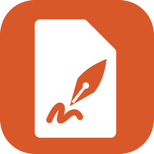

<p align="center">
  
</p>

<h1 align="center">Better PDF for Mac</h1>

<p align="center">
  <strong>The PDF app your Mac should have come with.</strong><br>
  Read without glare, fill any form, scan from your iPhone and sign with a certificate, smart card or USB token.
</p>

<p align="center">
  <a href="https://github.com/prashantguleria/betterpdf-releases/releases/latest"></a>
</p>

<p align="center">
  <a href="https://betterpdf.co">betterpdf.co</a> ·
  <a href="https://betterpdf.co/help/">Help</a> ·
  <a href="CHANGELOG.md">Changelog</a> ·
  <a href="https://betterpdf.co/privacy/">Privacy</a> ·
  <a href="mailto:hello@evenpine.com">Support</a>
</p>

---

This repository is where the **direct download** of Better PDF is published: the notarised
DMG for each version, its SHA-256 checksum and the release notes. Better PDF is made by
[Evenpine](https://evenpine.com). The app is proprietary and its source code is not public;
nothing here is source code (see [LICENSE-NOTICE.md](LICENSE-NOTICE.md)).

## What Better PDF is

A calm, native PDF app for macOS, built with SwiftUI and PDFKit. No account, no
subscription, and nothing leaves your Mac on its own.

- **Read** in light, dark, night or an e-ink mode, with tabs, bookmarks and search that finds
  every match.
- **Annotate** with highlight, underline, strikeout, notes and freehand drawing.
- **Fill** any form, even a flat scan, and **sign** with a drawn or typed signature or with a
  certificate from your keychain, a smart card or a USB token (PAdES, optional RFC 3161
  timestamp).
- **Scan** with your iPhone through Continuity Camera; the text is recognised on your Mac.
- **Organise pages**: reorder, rotate, split and merge from one grid.

It is free to download. The first launch gives you seven days of full Pro; after that,
reading, filling, signing, scanning and the Tools window's conversions stay free. Pro adds
editing, redaction, password protection and PDF to Word for one payment. Details on
[betterpdf.co](https://betterpdf.co).

## Download

1. Open the [latest release](https://github.com/prashantguleria/betterpdf-releases/releases/latest)
   and download `BetterPDF-<version>.dmg`. Each release also carries
   `BetterPDF-<version>.dmg.sha256`.
2. Open the DMG and drag **Better PDF** to **Applications**.
3. Open it from Applications. Press <kbd>⌘O</kbd> to open a PDF, or drop one on the window.

Prefer the Mac App Store? The App Store edition is the same app, updated through the App
Store; its link is on [betterpdf.co/download](https://betterpdf.co/download/) once it is live.

### System requirements

| | |
|---|---|
| macOS | macOS 26 Tahoe or later |
| Processor | Apple silicon and Intel (universal) |
| Signing tokens | Keychain certificates and CryptoTokenKit smart cards; the direct download also loads PKCS#11 token drivers, such as the Watchdata ProxKey |

## Verify the download

Every DMG and the app inside it are signed with the Developer ID
**Prashant Guleria (8M3KXKK7JB)**, notarised by Apple, and have the notarisation ticket
stapled, so Gatekeeper can check them offline. You can check all of this yourself in
Terminal, from the folder you downloaded to.

**1. The checksum matches the release.**

```sh
shasum -a 256 -c BetterPDF-<version>.dmg.sha256
```

It prints `BetterPDF-<version>.dmg: OK`.

**2. The DMG is signed with the Developer ID and notarised.**

```sh
spctl --assess --type open --context context:primary-signature --verbose=2 BetterPDF-<version>.dmg
xcrun stapler validate BetterPDF-<version>.dmg
```

`spctl` prints `accepted`, `source=Notarized Developer ID` and
`origin=Developer ID Application: Prashant Guleria (8M3KXKK7JB)`. `stapler` (part of the
Xcode command line tools) prints `The validate action worked!`.

**3. The installed app is intact and notarised.**

```sh
codesign --verify --deep --strict --verbose=2 "/Applications/Better PDF.app"
codesign --display --verbose=2 "/Applications/Better PDF.app" 2>&1 | grep -E "^(Identifier|Authority|TeamIdentifier)"
spctl --assess --type execute --verbose=2 "/Applications/Better PDF.app"
```

`codesign` prints `valid on disk` and `satisfies its Designated Requirement`, then
`Identifier=com.evenpine.betterpdf`, `Authority=Developer ID Application: Prashant Guleria (8M3KXKK7JB)`
and `TeamIdentifier=8M3KXKK7JB`. `spctl` prints `accepted` and `source=Notarized Developer ID`.

If any of these fail, do not open the app, and please tell us at
[hello@evenpine.com](mailto:hello@evenpine.com).

## Updates

The direct download updates itself with [Sparkle](https://sparkle-project.org).

- Once a day Better PDF reads the update feed at `https://betterpdf.co/appcast.xml`. The
  feed is served from betterpdf.co, not from this repository. The request carries no system
  profile.
- Every update is signed twice: an EdDSA signature in the feed that the app checks against
  the public key built into it, and Apple's Developer ID signature and notarisation on the
  update itself. An update that fails either check is not installed.
- It asks before installing anything. Turn checking off, or on, in **Settings › General**,
  or choose **Check for Updates…** in the Better PDF menu to look now.
- You can always install a newer DMG from this page by hand; your documents, signatures and
  settings stay where they are.

The Mac App Store edition has no updater of its own; it updates through the App Store.

## Privacy

Better PDF has no account, no analytics, no telemetry and no crash upload. The only network
requests it makes are:

- **The update check** against `https://betterpdf.co/appcast.xml` (direct download only), on
  by default and off in Settings › General.
- **Licence activation and deactivation** against `https://betterpdf.co/api/licence/`
  (direct download only), only when you press Activate or Deactivate. It sends the licence
  key, the email you typed and a salted hash that identifies the Mac to your licence, never
  your serial number, user name or hardware UUID.
- **RFC 3161 time-stamping** when you sign with a certificate, only if you turn it on (it is
  off by default), to the time-stamp server you choose.

The full policy is at [betterpdf.co/privacy](https://betterpdf.co/privacy/).

## Help and support

- Guides: [betterpdf.co/help](https://betterpdf.co/help/)
- Something wrong? Open an [issue](https://github.com/prashantguleria/betterpdf-releases/issues/new/choose).
  A **Help › Diagnostics…** zip helps a great deal: Better PDF shows you everything in it
  first, removes paths, email addresses, PINs and serials, and never includes your
  documents. You choose where it goes.
- Email: [hello@evenpine.com](mailto:hello@evenpine.com)
- Security issues: please read [SECURITY.md](SECURITY.md) and email us rather than opening a
  public issue.

---

<p align="center"><sub>Better PDF is made by <a href="https://evenpine.com">Evenpine</a>. © 2026 Evenpine. All rights reserved.</sub></p>
